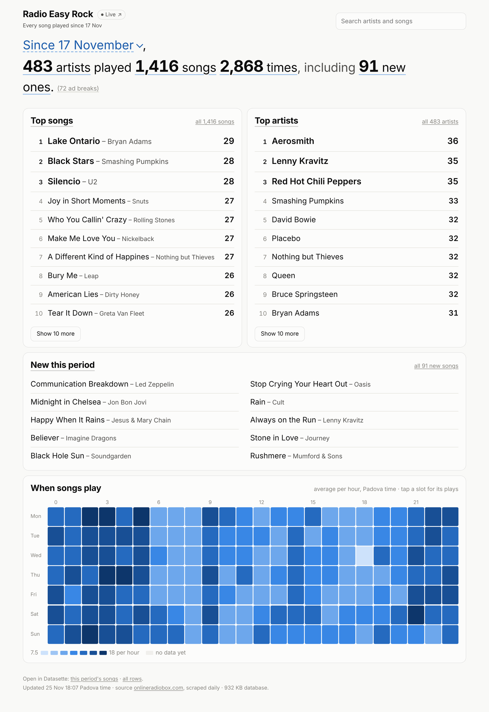
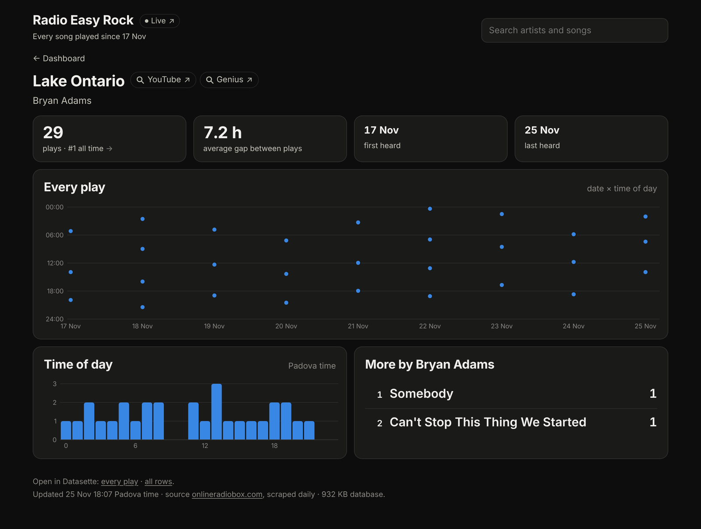

# easyrock-datasette

<table>
<tr>
<td width="55%" valign="top"><a href="https://insipid.github.io/easyrock-datasette/#p=all"></a></td>
<td width="45%" valign="top"><a href="https://insipid.github.io/easyrock-datasette/#song=66"></a></td>
</tr>
</table>

**Live at [insipid.github.io/easyrock-datasette](https://insipid.github.io/easyrock-datasette/)**, updated daily.
Above: the [dashboard](https://insipid.github.io/easyrock-datasette/#p=all) and a [song page](https://insipid.github.io/easyrock-datasette/#song=66) (in dark mode).

A running archive of every song played on [Radio Easy Rock](https://www.radioeasyrock.it/) (Padova),
scraped daily from [onlineradiobox](https://onlineradiobox.com/it/easyrock/playlist/), with a static dashboard
and [Datasette Lite](https://lite.datasette.io/) on GitHub Pages.

## How it works

| File | Role |
|---|---|
| `scrape.py` | Fetches the last 7 days of playlist pages and merges them into `data/days/YYYY-MM-DD.json` (raw, append-only). |
| `data/days/` | The source of truth. Committed daily by the Action. |
| `build.py` | Rebuilds `playlist.db` from scratch: classifies songs/idents/ads, title-cases, applies `overrides.csv`, adds stats views. |
| `overrides.csv` | `from,to` name fixes. A whole name/title replaces that one; a single word (e.g. `MJ`) replaces it everywhere. |
| `index.html` | The dashboard. Loads `playlist.db` in the browser with vendored [sql.js](https://github.com/sql-js/sql.js). |
| `metadata.yml` | Title/source for Datasette Lite. |
| `docs/` | README screenshots. |

`playlist.db` is never committed; it's rebuilt on every run.

## Local use

```sh
./scrape.py                  # needs uv; deps pinned in scrape.py.lock
./build.py                   # → playlist.db
python3 -m http.server       # → http://localhost:8000
uvx datasette playlist.db -m metadata.yml
```

After changing a script's dependencies: `uv lock --script <script>.py`.

## Automation

`.github/workflows/scrape-build-deploy.yml` runs daily at 04:17 UTC (scrape → commit → build → Pages)
and on pushes to `trunk` (build → Pages only). Actions are pinned to commit SHAs, Python deps are
locked with hashes, jobs get least-privilege tokens, and Dependabot proposes action updates after a
7-day cooldown.

Built with help from Claude.
